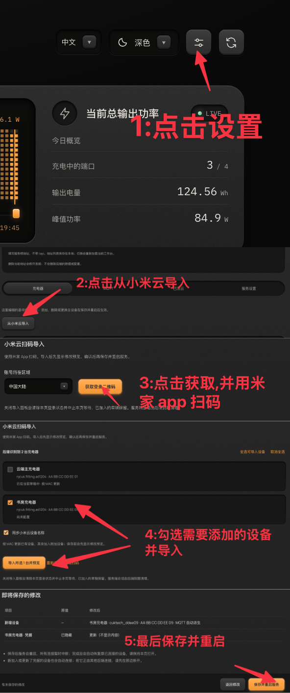

# CUKTECH Studio 发布与安装

[项目主页](https://morty626.github.io/cuktech-studio-releases/)提供工作台截图、Mac 安装包、Docker Compose 和校验文件。[安装指南](https://morty626.github.io/cuktech-studio-releases/guide/)说明了平台要求和更新方法。

## 添加充电器

1. 在工作台右上角打开「系统配置」。
2. 进入「充电器」选项卡，点击「从小米云导入」。
3. 选择米家账号所在区域，点击「获取登录二维码」，用米家 App 扫码确认。
4. 勾选要添加的充电器，点击「导入所选 … 台并预览」。
5. 核对设备名称和修改内容，点击「保存并重启服务」。回到工作台，在「设备与连接设置」中查看蓝牙连接状态。

[](docs/assets/add-charger.png)

## Mac 测试版

需要 Apple Silicon 和 macOS 14 或更新版本。可以在 [Releases](https://github.com/morty626/cuktech-studio-releases/releases) 下载 ZIP，解压并将 App 拖入「应用程序」。测试包使用临时签名，首次打开时 macOS 可能要求确认来源。

也可以通过 [项目 Homebrew Tap](https://github.com/morty626/homebrew-tap) 安装。已有手动安装的同名 App 时，先退出并将它移到备份位置，配对配置和历史继续使用原数据目录。

```sh
brew install --cask morty626/tap/cuktech-studio-beta
```

Homebrew 7 如提示信任，按提示仅信任这个 Cask。后续升级：

```sh
brew update
brew upgrade --cask morty626/tap/cuktech-studio-beta
```

## Linux Docker 测试版

需要 Docker Compose 2.24.4 或更新版本，以及 Linux 宿主机上的蓝牙适配器和 BlueZ。
将 [测试版 Compose 模板](https://raw.githubusercontent.com/morty626/cuktech-studio-releases/main/docker/compose.beta.yaml)
保存到新目录并命名为 `compose.yaml`。

```sh
docker compose up -d --wait --wait-timeout 120
```

工作台默认使用 [本机端口 28753](http://127.0.0.1:28753/)，后端默认端口为 28759。
安装前可在 YAML 顶部的 `x-cuktech-ports` 中修改端口。也可以从对应 Release 下载
内含固定版本和跟踪渠道的部署包及完整说明。

后续在原部署目录更新，继续使用原项目名和数据卷：

```sh
docker compose pull
docker compose up -d --wait --wait-timeout 120
```

`:beta` 指向最近一个通过联调的测试版。设置 `CUKTECH_VERSION=v0.1.0-beta.7` 可锁定版本。
遇到跨配置版本回退时，使用目标版本对应的部署包。正式版 `:latest` 由正式发布推进。
